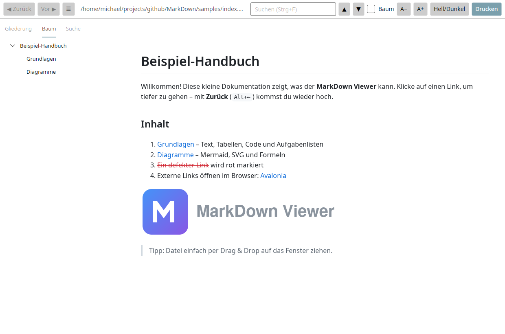
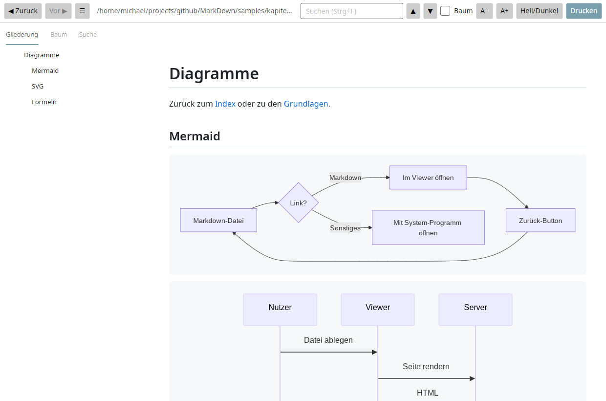
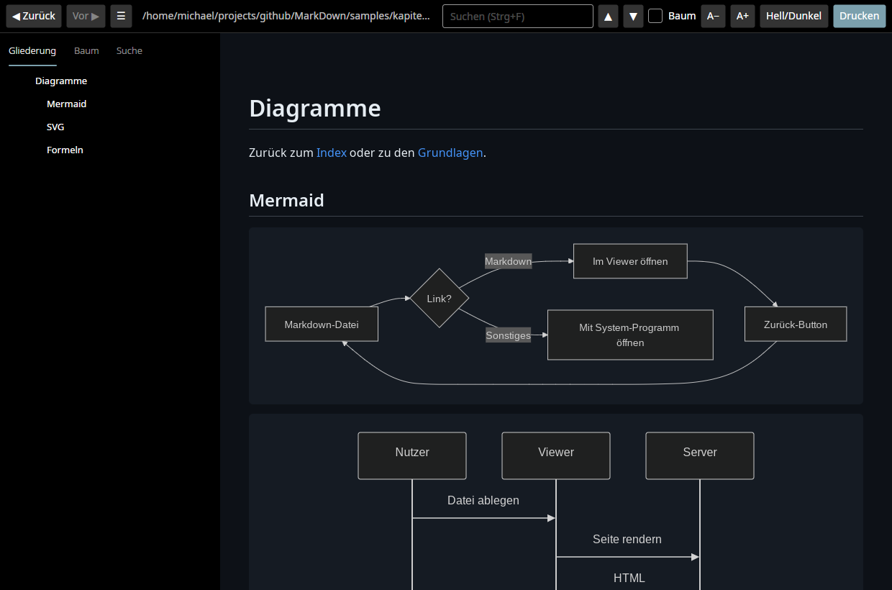
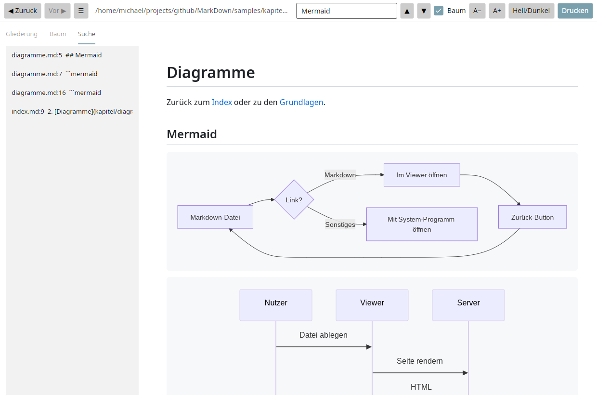
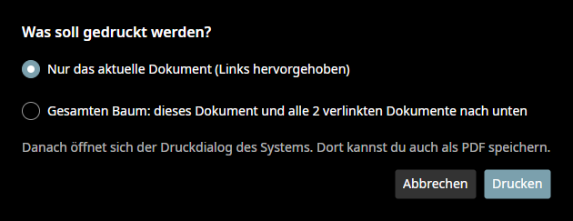
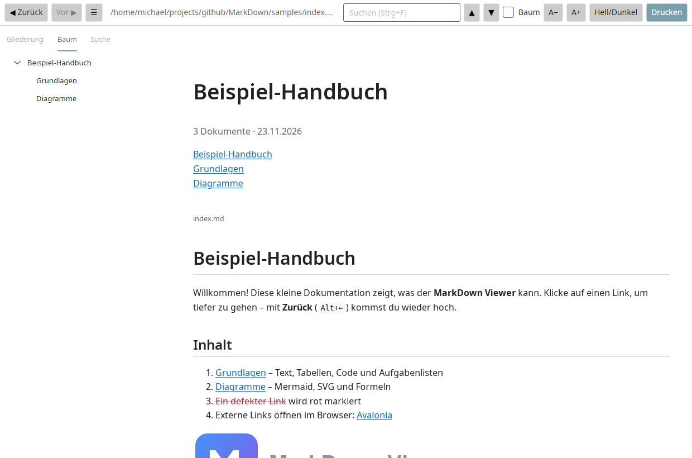

<h1 align="center">MarkDown Viewer</h1>

<p align="center">
Ein schneller Markdown-Viewer für ganze Dokumentationen – folgt Links von Datei zu Datei,
geht beliebig tief hinein und wieder zurück, zeigt Mermaid, SVG, Formeln und Bilder
und druckt auf Wunsch den kompletten Dokumentenbaum.
</p>

<p align="center">

</p>

> Gebaut mit **.NET 10** und **Avalonia 12**. Läuft auf **Windows** und **Linux**. Rein für den privaten Gebrauch.

## Download

Fertige Pakete gibt es unter **[Releases](../../releases)** – ohne Anmeldung:

| Plattform | Datei |
|---|---|
| Windows x64 | `markdown-viewer-win-x64.zip` – entpacken, `MarkDownViewer.exe` starten |
| Linux x64 | `markdown-viewer-linux-x64.tar.gz` – entpacken, `./MarkDownViewer` starten |

Es ist keine .NET-Installation nötig (self-contained). Voraussetzungen:

- **Windows:** WebView2-Runtime (in Windows 11 enthalten, sonst bei Microsoft kostenlos erhältlich)
- **Linux:** WebKitGTK 4.1 und GTK 3 (Fedora: `webkit2gtk4.1`, Debian/Ubuntu: `libwebkit2gtk-4.1-0`)
- Die Programme sind nicht signiert – Windows SmartScreen warnt beim ersten Start.

## Bedienung

**Datei öffnen:** einfach eine `.md`-Datei auf das Fenster ziehen. Kein Menü nötig. (Auch per Kommandozeile: `MarkDownViewer datei.md`, oder „Öffnen mit“.)

| Aktion | Wie |
|---|---|
| Link folgen | Klick auf den Link – Markdown-Dateien öffnen im Viewer, alles andere (PDF, HTML, Bilder, URLs) mit dem Standardprogramm |
| Zurück / Vor | Buttons, `Alt+←` / `Alt+→` oder Maus-Zurück/Vor-Taste |
| Suchen | `Strg+F`, `Enter` / `F3` = nächster Treffer, `Shift` = rückwärts. Mit Haken **Baum** in allen verlinkten Dokumenten |
| Drucken | Button **Drucken** oder `Strg+P` |
| Zoom | `Strg +` / `Strg −` / `Strg 0` |
| Theme | Button **Hell/Dunkel** |

## Funktionen

### Links folgen – nach unten und wieder zurück

Von einer `index.md` in ein Kapitel und weiter in ein Unterkapitel. Mit **Zurück** geht es Schritt für Schritt wieder nach oben – genau an die Stelle, an der man weggeklickt hat. Anker (`#abschnitt`) funktionieren innerhalb und zwischen Dateien. Defekte Links werden rot durchgestrichen.

Der **Baum**-Tab zeigt die Dokumentenstruktur **ab der aktuell angezeigten Datei**. Lädt man versehentlich eine Datei mitten im Baum, ist sie eben die neue Wurzel. Zyklen und „zurück zum Index“-Links machen keine Probleme.

### Alles, was Markdown kann

<p align="center">

</p>

- Tabellen, Aufgabenlisten, Fußnoten, Durchgestrichenes, Emoji
- **Mermaid**-Diagramme (Flussdiagramm, Sequenz, …), **SVG**, Bilder (lokal und aus dem Netz)
- **Formeln** mit KaTeX (`$E=mc^2$`)
- Code mit Syntax-Highlighting
- Gliederung der aktuellen Datei in der Seitenleiste

### Hell und Dunkel

<p align="center">

</p>

Mermaid und Code-Highlighting passen sich dem Theme an. Die Wahl wird gemerkt.

### Suche im ganzen Baum

<p align="center">

</p>

### Drucken – aktuelles Dokument oder der ganze Baum

<p align="center">

</p>

- **Nur das aktuelle Dokument:** Links sind blau und unterstrichen, dahinter steht klein das Ziel in Klammern.
- **Gesamter Baum:** Deckblatt mit Inhaltsverzeichnis, danach alle Dokumente nach unten in Lesereihenfolge – jedes einmal, jedes auf neuer Seite. Interne Links verweisen auf den jeweiligen Abschnitt.

Gedruckt wird **immer auf weißem Grund mit dunklem Text** – auch wenn du im dunklen Theme liest. Es gibt also nie schwarz gefüllte Seiten, die Toner oder Tinte verbrauchen. 

Danach öffnet sich der Druckdialog des Systems, dort geht auch **In Datei drucken (PDF)**.

<p align="center">

</p>

### Weiteres

- **Live-Reload:** Ändert sich die angezeigte Datei, lädt der Viewer neu – die Scroll-Position bleibt.
- **Zuletzt geöffnet** auf der Startseite.
- **Offline:** Mermaid, KaTeX und Highlighting sind eingebaut.

## Sicherheit

Markdown-Dateien können HTML enthalten. Der Viewer rendert über einen lokalen Server (nur `127.0.0.1`, Zufalls-Token) mit strikter Content-Security-Policy: Skripte aus Dokumenten, Event-Handler und Netzwerkzugriffe werden blockiert. Eine fremde `.md` kann also keine lokalen Dateien auslesen oder versenden. Zugriff auf Dateien ist ausschließlich lesend.

## Entwicklung

Der Quellcode liegt in `src/`, die Beispiel-Dokumentation für Tests und Screenshots in [`samples/`](samples/). Details stehen in der [Spezifikation](SPEC.md).

```
src/MarkDownViewer.Core   Engine: Markdig, lokaler Server, Baum, Verlauf, Suche (ohne UI)
src/MarkDownViewer        Avalonia-Oberfläche
tests/                    xUnit-Tests
```

Gebaut wird **ausschließlich über GitHub Actions**:

- `CI` – Build und Tests bei jedem Push (Ubuntu + Windows)
- `Release` – bei einem Tag `v*` entstehen die Pakete für Windows und Linux samt Prüfsummen als GitHub-Release; manuell gestartet baut der Workflow nur die Artefakte

Zum Ausprobieren der Beispiele: `samples/index.md` auf das Fenster ziehen.
