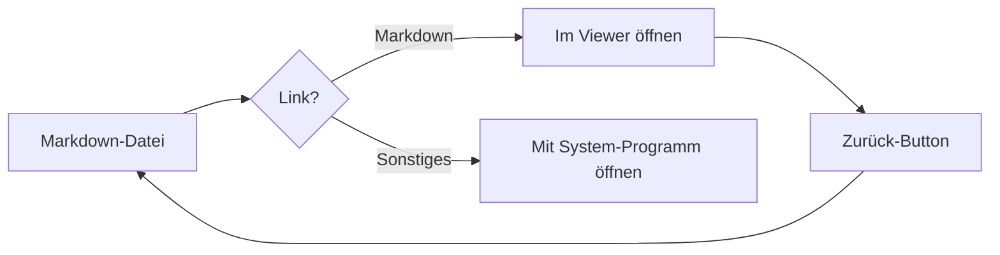
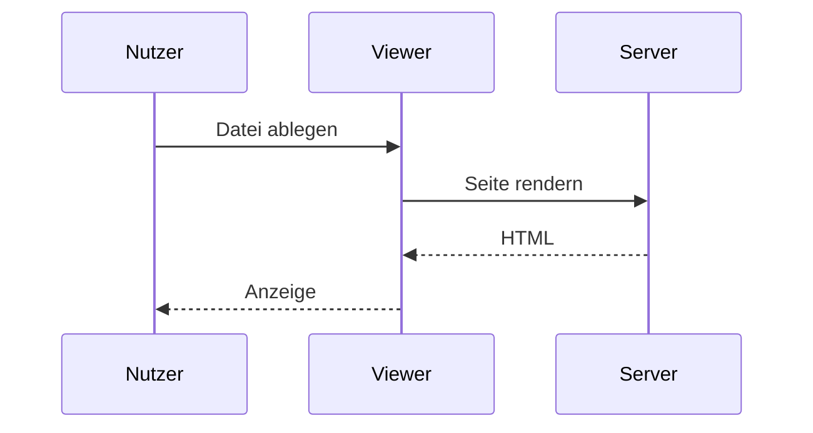

# Diagramme

Zurück zum [Index](../index.md) oder zu den [Grundlagen](grundlagen.md).

## Mermaid

## SVG

## Formeln

Inline: $E = mc^2$ und als Block:

$$
\int_0^\infty e^{-x^2}\,dx = \frac{\sqrt{\pi}}{2}
$$
